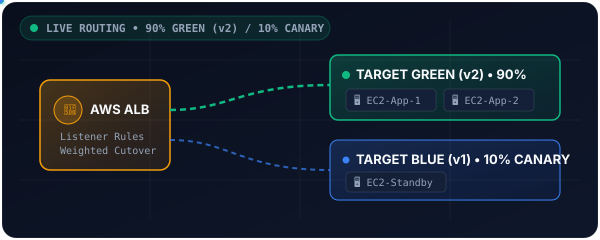
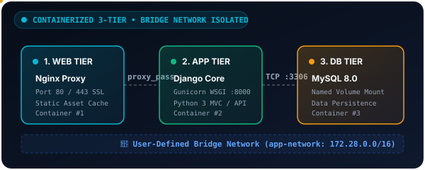
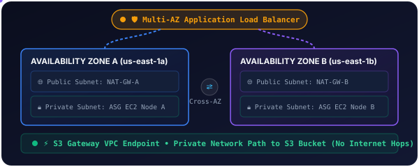
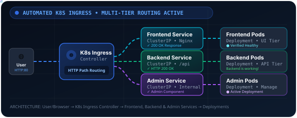
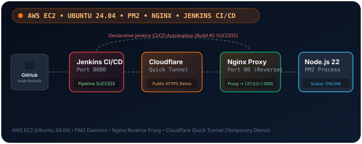

<div align="center">

  <!-- Dynamic Typing Header Banner -->
  <a href="https://jotibabhate04.github.io">
    
  </a>

  <p align="center">
    <strong>Bridging Code & Infrastructure • Automating Deployments • Building Resilient Systems</strong>
  </p>

  <!-- Quick Action Badges -->
  <p align="center">
    <a href="https://jotibabhate04.github.io" target="_blank">
      
    </a>
    <a href="https://www.linkedin.com/in/jotiba-bhate-a0055235a/" target="_blank">
      
    </a>
    <a href="mailto:jotibabhate@gmail.com">
      
    </a>
  </p>

  <p align="center">
    
    
    
  </p>

</div>

---

### ⚡ System Telemetry (`whoami.sh`)

```bash
$ neofetch --profile jotiba
```
```yaml
jotiba@cloud-control-plane
──────────────────────────
OS:          Linux (Ubuntu LTS / RHEL)
Role:        Aspiring DevOps Engineer & AWS Cloud Specialist
Education:   Bachelor of Computer Applications (BCA, Class of 2026)
Focus:       AWS Architecture, Docker Orchestration, CI/CD Automation
Philosophy:  "If you have to do it more than twice, automate it."
Status:      Ready to build, scale, and learn in production
Portfolio:   https://jotibabhate04.github.io
```

---

### 👨‍💻 Executive Summary

I am a hands-on **DevOps Engineer & Cloud Enthusiast** passionate about architecting fault-tolerant cloud environments and automated CI/CD delivery pipelines. Rather than just following theory, I build end-to-end production systems from scratch:

- ☁️ **AWS Infrastructure Design:** Designing multi-AZ VPC networks, Application Load Balancers, Auto Scaling Groups, and S3 Gateway VPC Endpoints.
- 🐳 **Containerization:** Containerizing multi-tier applications with custom multi-stage Dockerfiles and isolated Docker Compose bridge networks.
- 🔄 **Safe Release Engineering:** Executing zero-downtime Blue-Green deployment strategies with automated health checks and rapid traffic rollback.
- ⚙️ **Infrastructure Automation:** Automating routine operations with Bash scripting, declarative Jenkins pipelines, and Terraform infrastructure-as-code.

---

## 🚀 Live 3D Automated Project Architectures

### 1. 🔄 AWS Blue-Green Deployment
> Implemented an AWS Blue-Green Deployment lab using an Application Load Balancer to explore deployment strategies, traffic switching, and safe application releases.

[](https://github.com/jotibabhate04/AWS-Blue-Green-Deployment)

<p align="center">
  <a href="https://github.com/jotibabhate04/AWS-Blue-Green-Deployment">
    
  </a>
</p>

- **Tech Stack:** `AWS EC2`, `Application Load Balancer`, `Target Groups`, `Traffic Management`
- **Key Highlight:** Live weighted listener rules routing 90% traffic to Green and 10% canary traffic to Blue with instantaneous zero-downtime rollback.

---

### 2. 🐳 Three-Tier Django Notes Application
> Containerized a Django Notes application using a three-tier architecture consisting of Nginx as the web tier, Django as the application tier, and MySQL as the database tier.

[](https://github.com/jotibabhate04/Three-Tier-Django-Notes-Application)

<p align="center">
  <a href="https://github.com/jotibabhate04/Three-Tier-Django-Notes-Application">
    
  </a>
</p>

- **Tech Stack:** `Docker`, `Docker Compose`, `Nginx`, `Django`, `MySQL`, `Linux`
- **Key Highlight:** Decoupled presentation, WSGI application logic, and persistence tiers communicating securely over an isolated user-defined bridge network (`app-net`).

---

### 3. 🛡️ AWS High Availability Infrastructure
> Designed a highly available AWS infrastructure across two Availability Zones using public and private subnets, Application Load Balancer, Auto Scaling Groups, NAT Gateways, and S3 Gateway Endpoint.

[](https://github.com/jotibabhate04/AWS-high-availability-project)

<p align="center">
  <a href="https://github.com/jotibabhate04/AWS-high-availability-project">
    
  </a>
</p>

- **Tech Stack:** `AWS VPC`, `EC2`, `ALB`, `Auto Scaling`, `NAT Gateway`, `S3 Endpoint`
- **Key Highlight:** Active-Active multi-AZ resilience with cross-zone load balancing, private S3 gateway routing, and dynamic horizontal auto-scaling.

---

### 4. ☸️ Kubernetes Three-Tier Application Deployment
> Deployed a three-tier application consisting of Frontend, Backend, and Admin components on Kubernetes. Configured Kubernetes Deployments, Services, and Ingress to manage application components and route incoming HTTP traffic.

[](https://jotibabhate04.github.io#projects)

<p align="center">
  <a href="https://jotibabhate04.github.io#projects">
    
  </a>
</p>

- **Tech Stack:** `Kubernetes`, `Docker`, `Nginx`, `Ingress Controller`, `K8s Deployments`, `K8s Services`, `YAML`, `Linux`
- **Key Highlight:** Automated ingress traffic management routing external requests across dedicated ClusterIP services to Frontend, Backend, and Admin deployments; verified HTTP 200 OK across UI and API endpoints (`Backend is working successfully!`).

---

### 5. ⚡ Node.js Application Deployment using PM2, Nginx & Jenkins CI/CD
> Deployed a Node.js application on AWS EC2 Ubuntu 24.04 and implemented a Jenkins CI/CD pipeline to automate application deployment. Used PM2 for process management, Nginx as a reverse proxy, and Cloudflare Tunnel to provide temporary public HTTPS access.

[](https://github.com/jotibabhate04/nodejs-devops-project)

<p align="center">
  <a href="https://github.com/jotibabhate04/nodejs-devops-project" target="_blank">
    
  </a>
  <a href="https://jotibabhate04.github.io" target="_blank">
    
  </a>
</p>

- **Tech Stack:** `AWS EC2`, `Ubuntu 24.04`, `Node.js 22`, `PM2`, `Nginx`, `Jenkins`, `Jenkinsfile`, `Git & GitHub`, `Cloudflare Tunnel`
- **Key Highlight:** Declarative Jenkins CI/CD automation on AWS EC2 (Build #2 finished with SUCCESS); PM2 daemon process manager for automatic process recovery and host metrics; Nginx reverse proxy routing port 80 to port 3000.

---

### 🛠️ Technical Arsenal

<div align="center">

| Domain | Technologies & Tools |
| :--- | :--- |
| **Cloud & AWS** |  `EC2` `VPC` `ALB` `S3` `Auto Scaling` `IAM` `Security Groups` `NAT Gateway` |
| **Containers & K8s** |   `Docker Compose` `Multi-Stage Builds` `Bridge Networks` |
| **CI/CD & Automation** |     |
| **Operating Systems & Web** |     |
| **Languages & Databases** |     |

</div>

---

### 📊 GitHub Activity & Telemetry

<div align="center">
  
  
</div>

<div align="center">
  
</div>

---

### 📬 Connect With Me

<p align="center">
  <a href="https://www.linkedin.com/in/jotiba-bhate-a0055235a/">
    
  </a>
  <a href="mailto:jotibabhate@gmail.com">
    
  </a>
  <a href="https://instagram.com/jyotiba_bhate_04">
    
  </a>
  <a href="https://jotibabhate04.github.io">
    
  </a>
</p>

<p align="center">
  
</p>
